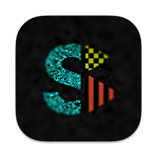
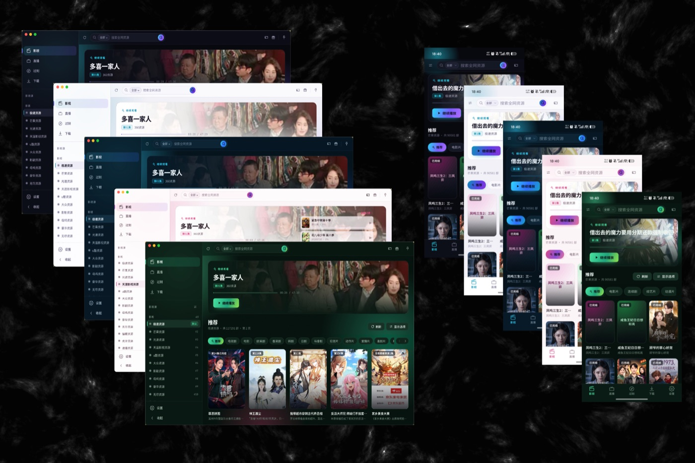
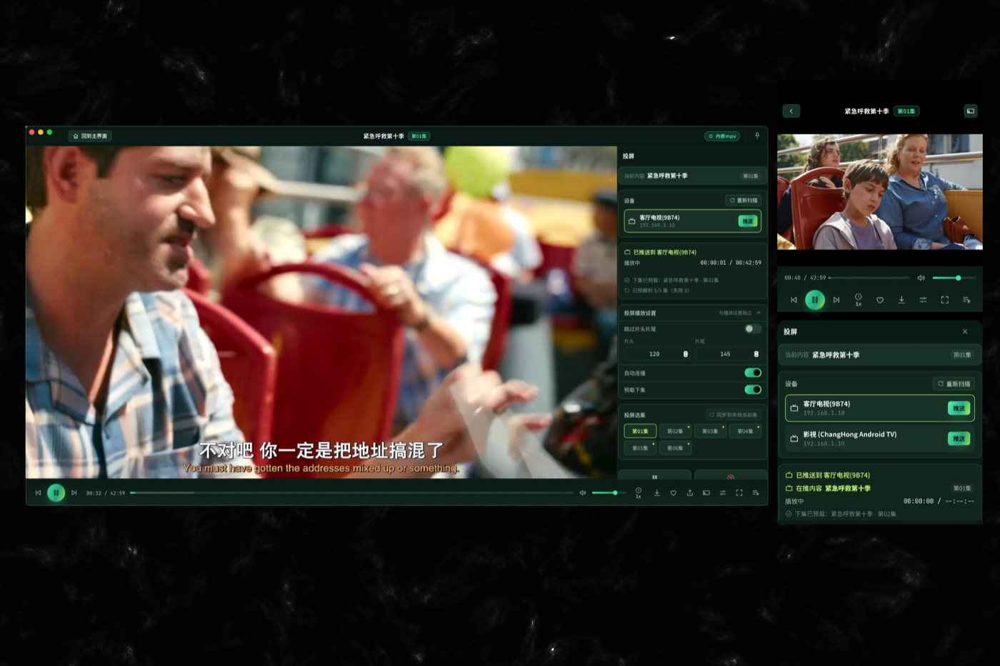
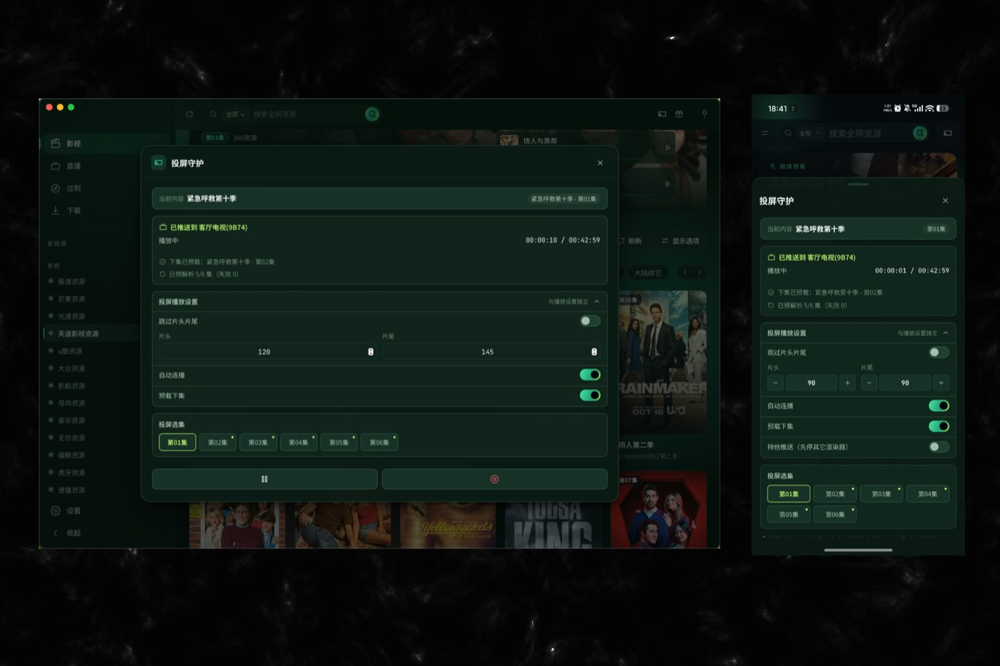
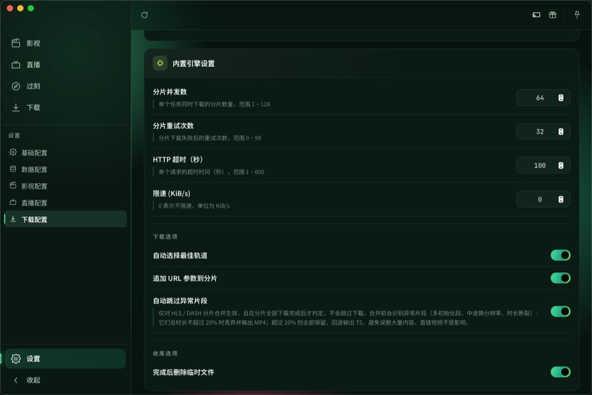

<div align="center">
  
  <h1>Strevia</h1>
  <p><b>片源、播放、下载、投屏，都在一个窗口里。</b></p>
  <p>
    
    
    
  </p>
  <p>
    <a href="https://github.com/Darling-Lee/Strevia/releases/latest"><b>⬇ 下载最新版</b></a>
    &nbsp;·&nbsp;
    <a href="#english">English</a>
  </p>
</div>

---

## 这是什么

Strevia 是一个使用 Rust + Tauri2 开发的影视聚合播放器。

把你常看的几个站点配进来，就能在同一个地方浏览、搜索、播放；看到想留的，直接下载；想放到大屏上看，一键投到电视。

不用在浏览器、播放器、下载工具之间来回搬地址，也不用为了投个屏再去装一个专门的投屏软件。

> 片源由你自己配置，Strevia 不提供任何内容。

## 亮点

**一个窗口，从找片到投到电视**<br>
浏览、详情、选集、播放、下载、投屏，都在同一个应用里完成。

**五套皮肤，整套重做**<br>
深色、浅色、深海、松林、樱雾。换肤是整套界面一起换，不是局部换个颜色；也可以跟随系统自动切换。

**手机不是"另一个 App"**<br>
安卓版和桌面版是同一套界面、同一套功能。皮肤一样，投屏一样，下载引擎也一样。

**投屏之后可以走开**<br>
只要设备与电视保持在同一个局域网内：投屏守护会替你盯着电视，播到哪了、下一集有没有就绪，随时能看；切集、暂停、继续，随时能动手。就算把播放页关掉，投屏也不会断。

**下一集提前备好**<br>
推送的那一刻起，整部剧每一集的播放地址就开始准备。电视播完自动接上，不用临时解析。

**老 Mac 也能打开**<br>
最低支持 macOS 12，Intel 和 Apple 芯片共用一个安装包。

**下载不用装任何外部工具**<br>
内置下载引擎，装好就能下。不依赖 ffmpeg，也不需要命令行工具。

## 界面

<div align="center">
  
  <p><sub>五套皮肤与手机版：左列为桌面版，右列为手机版</sub></p>
</div>

## 功能

### 找片与浏览

- 支持标准苹果CMS接口片源，可同时配置多个站点
- 分类浏览、关键词搜索、详情页与选集
- 收藏与观看历史，跨会话保留
- 内置网页播放地址解析，遇到需要解析的站点不用跳出应用

### 播放

- 内嵌 mpv 播放器：解码能力更强，流媒体格式支持更广（HLS、DASH、直链与直播流）
- 音频五段 EQ 与画面调节（亮度、对比度、饱和度、色调、伽马），支持画面旋转与水平/垂直翻转
- 四线程预取：边播边把后续分片提前缓存到本地，网络波动时也不容易卡
- 倍速 0.75×–3×，会记住你上次选的档位
- 多画质切换
- 手势控制与键盘快捷键
- 跳过片头片尾，可分别设置时长
- 自动连播：一集结束自动接下一集
- 回拖缓存：往回拖进度条不断声

### 五套皮肤

| 皮肤 | 气质 | 适合 |
| --- | --- | --- |
| 深色 | 纯黑底、低亮度 | 关灯看片 |
| 浅色 | 白底、克制描边 | 白天、办公环境 |
| 深海 | 深蓝调、冷色点缀 | 喜欢冷色的人 |
| 松林 | 墨绿调、柔和层次 | 长时间观看 |
| 樱雾 | 浅粉调、低饱和 | 喜欢浅色但嫌纯白太刺眼 |

主窗口、播放窗口、侧页、弹窗共用同一套配色规则，换肤不会出现"一半新一半旧"。

### 投屏到电视

- 同一局域网内自动发现电视、盒子，不用输 IP
- **只推原始直链**：电脑不中转、不转码，电视拿到的是源站原画，也不额外占用电脑带宽
- **投屏守护**：独立面板显示电视端状态、播放进度和整部剧的地址准备情况；可直接切集、暂停、继续、退出
- **自动连播**：推送时就把整部剧每一集的地址准备好，电视播完自动接下一集
- **排他推送**：推送前先停掉同一台电视上的其它投屏，避免被家里另一台设备顶掉

<div align="center">
  
  <p><sub>播放页侧边的投屏面板；右列为手机端，设备会自动出现</sub></p>
</div>

<div align="center">
  
  <p><sub>左：桌面端守护面板；右：手机端同一面板</sub></p>
</div>

### 下载

- 内置下载引擎，支持 HLS、DASH 与直链，不需要安装任何外部工具
- 多任务同时下载，可自行调整同时下载的任务数
- 单个任务可分片并行，档位可调到很高；网络不好时调低更稳
- 断点续传、失败自动重试、限速、自定义请求头
- 自动挑选最合适的轨道
- **异常片段处理**：能识别多初始化段、中途换分辨率、时长断裂这类问题。默认全部保留（无损优先）；开启"自动跳过异常片段"后，异常总时长不超过 20% 时丢弃并输出 MP4，超过 20% 时全部保留、改输出 TS，宁可文件大一点也不误删内容

<div align="center">
  
  <p><sub>下载设置：并发、重试、超时、限速、异常片段处理全部开放</sub></p>
</div>

### 直播

- 导入直播源，按分组浏览频道
- 频道测速与线路标记，挑快的看
- 频道表与测速结果会本地留存，切走再回来不必重新测

### 语言与外观

- 简体中文、繁體中文、English
- 浅色 / 深色跟随系统
- 侧页打开时控制栏不会自己消失，关掉再重新计时

## 系统要求

| 平台 | 要求 |
| --- | --- |
| Windows | Windows 10 及以上，x64 或 arm64 |
| macOS | macOS 12.0 及以上，Intel / Apple 芯片通用 |
| Linux | x86_64 |
| Android | 8.0 及以上，arm64-v8a |

## 下载

全部安装包都在 [Releases](https://github.com/Darling-Lee/Strevia/releases/latest) 页面。

| 平台 | 文件 |
| --- | --- |
| macOS | `Strevia-0.1.5-MacOS-Universal-Installer.pkg` |
| Windows x64 | `Strevia-0.1.5-Windows-x64-Installer.exe` |
| Windows arm64 | `Strevia-0.1.5-Windows-arm64-Installer.exe` |
| Linux x86_64 | `Strevia-0.1.5-Linux-x86_64-Installer` |
| Android | `Strevia-0.1.5-Android-Phone-arm64-v8a-Installer.apk` |

## 安装

**macOS**<br>
双击 pkg 安装。安装包没有购买开发者签名，首次打开如果被系统拦下，右键点击应用图标选择「打开」，或在「系统设置 → 隐私与安全性」里允许一次即可。
投屏需要访问本地网络，首次投屏时系统会询问，请选择允许。

**Windows**<br>
按机型选 x64 或 arm64，不要混用。运行安装程序按提示完成。

**Linux**<br>
给安装器加执行权限后直接运行：

```bash
chmod +x Strevia-0.1.5-Linux-x86_64-Installer
./Strevia-0.1.5-Linux-x86_64-Installer
```

**Android**<br>
安装前需要在系统里允许安装未知来源应用。

## 常见问题

**投屏搜不到电视？**<br>
确认手机或电脑与电视在同一个局域网内；访客网络和开启了"AP 隔离"的路由器会让设备互相看不见；部分路由器会过滤组播，可以稍等几秒让应用换一种方式再找一次。投屏全程都要求设备与电视保持在同一局域网，中途换网或断开，投屏会中断。

**下载速度上不去？**<br>
先看限速是不是设了上限；网络不稳时把分片并发调低反而更快；失败重试次数过高会让慢速源拖很久。

**数据存在哪里？**<br>
片源配置、收藏、历史、下载任务都保存在本机，不上传任何服务器。换机时可以导出再导入。

**支持哪些片源？**<br>
标准苹果CMS接口的站点。片源需要你自己准备和配置。

**支持哪些直播源？**<br>
M3U / TXT 格式的频道清单，支持远程地址、本地文件和直接粘贴文本三种方式；带 `#EXTINF` 的标准 M3U 与常见的 TXT 频道列表都能解析，频道分组、台标和回看参数会一并识别。直播源同样需要你自己准备，Strevia 不内置任何频道。

## 反馈

遇到问题或有建议，欢迎提 [Issue](https://github.com/Darling-Lee/Strevia/issues)。

---

<div id="english"></div>

# English

<div align="center">
  <p><b>Your sources, player, downloads and casting — in one window.</b></p>
</div>

## What is Strevia

Strevia is a media aggregation player built with Rust and Tauri 2, for the sources you configure yourself.

Add the sites you already use, then browse, search and play them in one place. Keep what you want with the built-in downloader. Send it to your TV with one click — no extra casting app required.

> Strevia ships no content. You bring your own sources.

## Screenshots

<div align="center">
  
  <p><sub>Five themes and the phone app: desktop on the left, mobile on the right</sub></p>
</div>

## Highlights

**One window, from browsing to the TV**<br>
Browse, pick an episode, play, download and cast without bouncing between a browser, a player and a download tool.

**Five themes, fully redrawn**<br>
Dark, Light, Ocean, Forest and Sakura. Switching a theme repaints the whole interface — main window and player together — or just follow the system.

**The phone app is not a different app**<br>
Android and desktop share the same interface and the same features: same themes, same casting, same download engine.

**Walk away while it casts**<br>
As long as your device and the TV stay on the same local network, the cast guard keeps an eye on the TV: progress, the next episode, and controls for switching, pausing or stopping. Close the player page — casting keeps running. Switching networks or dropping off the LAN interrupts the cast.

**The next episode is already prepared**<br>
From the moment you start casting, playback addresses for every episode are prepared in the background. When one ends, the next one is ready to go.

**Runs on older Macs**<br>
macOS 12 and up, with a single universal build for Intel and Apple silicon.

**No external tools needed for downloads**<br>
The download engine is built in. No ffmpeg, no command-line utilities.

## Features

### Browsing

- Standard Apple CMS (v10) sources, multiple sites at once
- Category browsing, search, details and episode lists
- Favorites and watch history, kept between sessions
- Built-in page resolution for sources that need it

### Playback

- Built-in player: HLS, DASH, direct links and live streams
- Embedded mpv engine: stronger decoding and broader streaming-format support
- Five-band audio EQ and picture controls (brightness, contrast, saturation, hue, gamma), plus rotation and horizontal/vertical flip
- Four-thread prefetch: upcoming segments are cached ahead of playback, so network hiccups don't interrupt viewing
- Playback speed from 0.75× to 3×, remembered for next time
- Multiple quality levels
- Touch gestures and keyboard shortcuts
- Skip intro and outro, with adjustable durations
- Auto-play next episode
- Backward seeking with a proper back buffer

### Casting to a TV

- Automatic discovery of TVs and boxes on the same local network
- **Direct links only**: nothing is relayed or transcoded, so the TV gets the original stream and your computer's bandwidth stays free
- **Cast guard**: a panel with the TV's state, playback position and address readiness; switch episodes, pause, resume or stop from there
- **Auto next**: every episode's address is prepared up front, so the next one starts right after the current one ends
- **Exclusive push**: stops other casters on the same TV first, so nothing gets hijacked

<div align="center">
  
  <p><sub>The cast panel beside the player; the phone app is on the right</sub></p>
</div>

<div align="center">
  
  <p><sub>Left: cast guard on desktop. Right: the same panel on mobile</sub></p>
</div>

### Downloads

- Built-in engine for HLS, DASH and direct links — no external binaries
- Several downloads at once, with an adjustable task limit
- Per-task parallel segments, adjustable from conservative to aggressive
- Resume, automatic retries, speed limiting and custom request headers
- Automatic selection of the best track
- **Handling broken streams**: detects multiple init segments, mid-stream resolution changes and duration gaps. By default everything is kept; with "skip abnormal segments" enabled, abnormal groups under 20% of total duration are dropped and the result is an MP4, while anything above 20% keeps every segment and falls back to TS — never silently deleting content

<div align="center">
  
  <p><sub>Download settings: concurrency, retries, timeouts, speed limit and broken-stream handling</sub></p>
</div>

### Live TV

- Import live source lists and browse by group
- Channel speed tests and route markers
- Lists and test results are cached locally, so switching away and back is instant

### Languages and appearance

- Simplified Chinese, Traditional Chinese and English
- Light and dark follow the system
- The control bar stays put while side panels are open

## Requirements

| Platform | Requirement |
| --- | --- |
| Windows | Windows 10 or later, x64 or arm64 |
| macOS | macOS 12.0 or later, universal build |
| Linux | x86_64 |
| Android | Android 8.0 or later, arm64-v8a |

## Download

All installers are on the [Releases](https://github.com/Darling-Lee/Strevia/releases/latest) page.

| Platform | File |
| --- | --- |
| macOS | `Strevia-0.1.5-MacOS-Universal-Installer.pkg` |
| Windows x64 | `Strevia-0.1.5-Windows-x64-Installer.exe` |
| Windows arm64 | `Strevia-0.1.5-Windows-arm64-Installer.exe` |
| Linux x86_64 | `Strevia-0.1.5-Linux-x86_64-Installer` |
| Android | `Strevia-0.1.5-Android-Phone-arm64-v8a-Installer.apk` |

## Installation

**macOS** — Open the pkg and install. The build is not notarized, so if macOS blocks the first launch, right-click the app and choose *Open*, or allow it once in *System Settings → Privacy & Security*. Casting needs local network access; allow it when prompted.

**Windows** — Pick x64 or arm64 for your machine and run the installer.

**Linux** — Make the installer executable and run it:

```bash
chmod +x Strevia-0.1.5-Linux-x86_64-Installer
./Strevia-0.1.5-Linux-x86_64-Installer
```

**Android** — Allow installing apps from unknown sources before installing the APK.

## FAQ

**The TV doesn't show up.** Make sure your phone or computer and the TV are on the same local network. Guest networks and AP isolation hide devices from each other, and some routers filter multicast — give it a few seconds to try another discovery method. Casting requires both devices to remain on the same LAN throughout; switching networks or leaving the LAN interrupts the cast.

**Downloads are slow.** Check the speed limit first. Lowering segment concurrency often helps on unstable networks, and very high retry counts can make a slow source drag on.

**Where is my data?** Sources, favorites, history and download tasks stay on your device. Nothing is uploaded. You can export and import them when switching machines.

**Which sources are supported?** Standard Apple CMS (v10) APIs. You provide and configure the sources yourself.

**Which live sources are supported?** M3U / TXT channel playlists, from a remote URL, a local file, or text pasted directly. Standard M3U lists with `#EXTINF` and common TXT channel lists are both parsed, along with groups, logos and catch-up parameters. You bring your own live sources — Strevia ships no channels.

## Feedback

Issues and suggestions are welcome in [Issues](https://github.com/Darling-Lee/Strevia/issues).

---

<p align="center"><sub>Strevia 0.1.5 · Windows · macOS · Linux · Android</sub></p>
